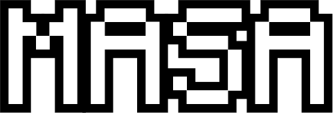



<b>⚠️ THIS MENU IS NOT READY FOR USE! ⚠️</b>

# 

Why make your menu open source? Well, do you really think it's worth gate keeping some cheats for a gorilla game? And, it help other's learn how to make their own mods.
 Nothing that happens to you while using Masa is my or any of the contributor's problem, it is all on you.

Also, please don't be an annoying person with this. I made this to learn more about C# and reverse engineering and stuff.

Wanna contribute? Go ahead and fork this repo with your changes, I will accept it if there are no super major changes, vibe coded changes and there needs to clearly have thought put behind it.

> Masa is an unofficial project and is not affiliated with, endorsed by, or sponsored by Gorilla Tag or Another Axiom. All respective assets and trademarks belong to their owners.